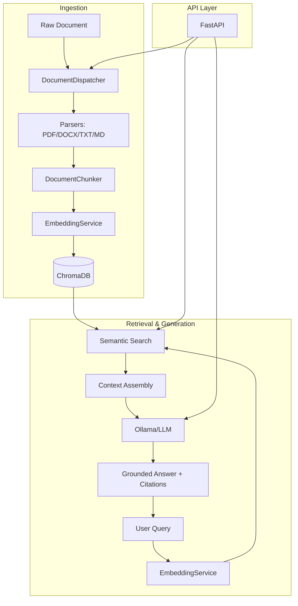

# System Architecture: Enterprise Knowledge Copilot

## Overview
The Enterprise Knowledge Copilot is a Retrieval-Augmented Generation (RAG) system designed to provide grounded answers to questions based on a private corpus of organizational documents.

## 1. Document Ingestion Pipeline
The ingestion process transforms raw files into a searchable vector database:

**Parsing $\rightarrow$ Normalization $\rightarrow$ Chunking $\rightarrow$ Embedding $\rightarrow$ Indexing**

- **Parsing**: The `DocumentDispatcher` identifies the file extension and routes it to the appropriate parser (`PDFParser`, `DocxParser`, `TxtParser`, or `MarkdownParser`).
- **Normalization**: Text is cleaned and normalized to ensure consistent embedding quality.
- **Chunking**: The `DocumentChunker` splits documents into overlapping segments (default: 200 tokens, 40 overlap). Each chunk preserves metadata: `doc_id`, `source`, `page_number`, and `heading`.
- **Embedding**: Chunks are converted into dense vectors using the `sentence-transformers/all-MiniLM-L6-v2` model.
- **Indexing**: Vectors and metadata are persisted in **ChromaDB** using cosine similarity for distance measurement.

## 2. Retrieval and Generation Loop
When a user submits a query, the system follows these steps:

1. **Query Embedding**: The query text is embedded using the same model used for indexing.
2. **Semantic Search**: ChromaDB retrieves the top $N$ chunks (default $N=5$) most similar to the query vector.
3. **Context Assembly**: Retrieved chunks are aggregated into a structured context prompt.
4. **Grounded Generation**: The prompt is sent to the LLM (Ollama/Qwen2.5). The system instructs the LLM to answer **only** using the provided context.
5. **Abstention**: If the retrieved context contains no relevant information, the system is designed to return a standard abstention message.
6. **Citation Mapping**: The final answer is returned alongside the specific `SourceDetail` objects (filename, page, heading) used for the response.

## 3. API and Frontend Integration
- **FastAPI Layer**: A thin REST API provides endpoints for `/health`, `/documents` (upload), and `/query`.
- **Dependency Injection**: Services (`QuestionAnsweringService`, `ChromaDocumentStore`) are injected into route handlers.
- **React Frontend**: A Vite-based UI provides a chat-like experience, handling multipart uploads and rendering structured source citations.

## 4. Evaluation and Testing Strategy
- **Deterministic Testing**: A comprehensive suite of unit tests mocks the LLM and embedding services to verify the logic of parsing, chunking, and retrieval without external dependencies.
- **Live Integration**: Marked with `@pytest.mark.live`, these tests verify the end-to-end loop with a running Ollama instance.
- **Regression Suite**: Tests ensure that critical fixes (e.g., persistence robustness) are not reverted.

## 5. Architecture Diagram (Mermaid)

