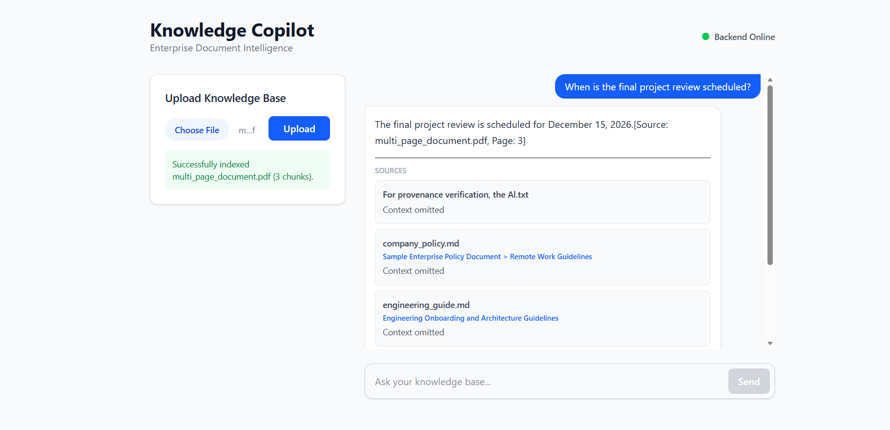
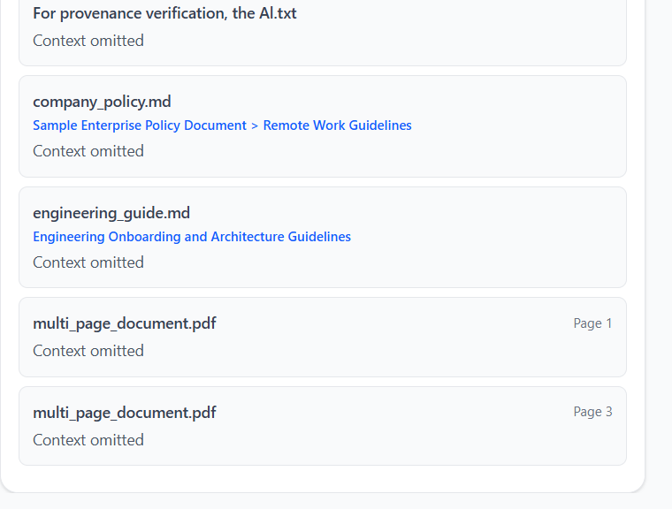
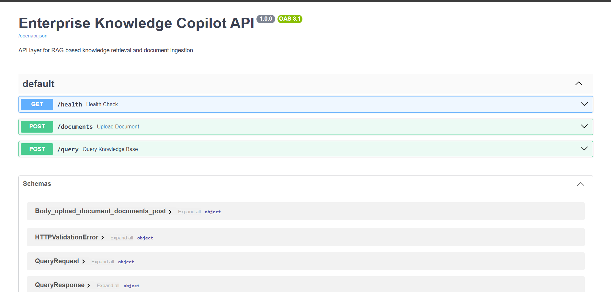

# Enterprise Knowledge Copilot

A professional, locally runnable, evidence-grounded Retrieval-Augmented Generation (RAG) application designed for querying organizational documents. This system allows users to upload various document formats, index them into a persistent vector store, and receive grounded answers with verifiable citations.

## 🚀 Key Features

- **Multi-Format Ingestion**: Native support for PDF, DOCX, TXT, and Markdown files.
- **Persistent Knowledge Base**: Uses ChromaDB for persistent vector storage and semantic retrieval across indexed document chunks.
- **Evidence-Grounded QA**: Uses retrieved document context to ground generated answers. This helps reduce unsupported responses, but does not guarantee that every answer is correct.
- **Verifiable Citations**: Returns source metadata when available, including filenames, page numbers, and section headings, helping users inspect the evidence behind an answer.
- **Smart Abstention**: The system explicitly abstains from answering when the retrieved evidence is insufficient to provide a grounded response.
- **Modern API & UI**: A thin FastAPI backend paired with a clean React 19 + Vite frontend.

## 🛠 Technology Stack

### Backend
- **Language**: Python 3.13.5
- **API Framework**: FastAPI & Uvicorn
- **Vector Database**: ChromaDB (Persistent)
- **Embeddings**: Sentence-Transformers (`all-MiniLM-L6-v2`)
- **Generation**: Ollama (default: `qwen2.5:7b`)
- **Parsing**: `pypdf`, `python-docx`

### Frontend
- **Framework**: React 19 + Vite + TypeScript
- **Styling**: Tailwind CSS
- **Communication**: Axios

## 🏗 High-Level Architecture

1. **Ingestion**: Documents $\rightarrow$ Parsing $\rightarrow$ Normalization $\rightarrow$ Chunking $\rightarrow$ Embedding $\rightarrow$ ChromaDB.
2. **Retrieval**: Query $\rightarrow$ Embedding $\rightarrow$ Semantic Search $\rightarrow$ Top-N Context Chunks.
3. **Generation**: Question + Context $\rightarrow$ LLM $\rightarrow$ Grounded Answer with Citations.

## 🏁 Getting Started

### Prerequisites
- **Python 3.13.5+**
- **Node.js & npm** (for frontend)
- **Ollama** installed and running locally with the `qwen2.5:7b` model pulled:
  ```bash
  ollama pull qwen2.5:7b
  ```

### Installation

1. **Clone the repository**
2. **Backend Setup**:
   ```powershell
   # Create and activate virtual environment
   python -m venv .venv
   .\.venv\Scripts\activate
   pip install -r requirements.txt
   ```
3. **Frontend Setup**:
   ```bash
   cd frontend
   npm install
   ```

### Running the Application

You will need two separate terminals:

**Terminal 1: Backend**
```powershell
.\.venv\Scripts\python app/main.py
```

**Terminal 2: Frontend**
```bash
cd frontend
npm run dev
```
The frontend will typically be available at `http://localhost:5173`.

## ⚙️ Configuration

Create a `.env` file in the project root (see `.env.example`):

```env
# Backend Configuration
CHROMA_PATH=chroma_db
EMBED_MODEL=sentence-transformers/all-MiniLM-L6-v2
CHUNK_SIZE=200
CHUNK_OVERLAP=40
OLLAMA_HOST=http://localhost:11434
LLM_MODEL=qwen2.5:7b

# Frontend Configuration (in frontend/.env)
VITE_API_BASE_URL=http://localhost:8000
```

## 🔌 API Endpoints

### `GET /health`
Checks if the API is online.
- **Response**: `{"status": "ok"}`

### `POST /documents`
Uploads and indexes a document.
- **Payload**: `multipart/form-data` containing a `file` field.
- **Response**: `{"status": "indexed", "filename": "...", "chunks_indexed": 12}`

### `POST /query`
Asks a question against the knowledge base.
- **Payload**:
  ```json
  {
    "question": "When is the final project review?",
    "limit": 5
  }
  ```
- **Response**:
  ```json
  {
    "answer": "The final project review is scheduled for December 15, 2026.",
    "sources": [
      {
        "source": "project_plan.pdf",
        "text": "...",
        "page_number": 3,
        "heading": "Roadmap"
      }
    ],
    "metadata": { "model": "qwen2.5:7b", "chunks_retrieved": 3 }
  }
  ```

## 🧪 Testing

### Deterministic Tests
Run the full suite of unit and integration tests without requiring a live LLM:
```powershell
.\.venv\Scripts\python -m pytest -m "not live"
```

### Live Integration Tests
Verify the end-to-end flow with a running Ollama instance:
```powershell
.\.venv\Scripts\python -m pytest -m live
```

## ⚠️ Known Limitations
- **Retrieval Ranking**: The current system uses semantic search, and the most relevant chunk may not always rank first. In our PDF test, the correct page was retrieved within the top five results, but ranking quality remains an area for improvement.

## 🛠 Troubleshooting
- **CORS Errors**: Ensure the backend is started via `app/main.py` to enable the configured `CORSMiddleware`.
- **Ollama Connection**: Verify Ollama is running by visiting `http://localhost:11434`.
- **File Permissions**: On Windows, if `shutil.rmtree` fails during tests, ensure no other process (like an open file explorer) is locking the `temp_chroma_db` folder.
## Screenshots

### 1. Knowledge Copilot Interface

The main workspace for uploading documents and asking questions.



### 2. Grounded Answers and Citations

Answers include source references to help users verify the retrieved evidence.



### 3. FastAPI Documentation

Interactive API documentation for the health, document upload, and question-answering endpoints.

